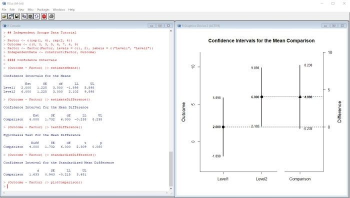
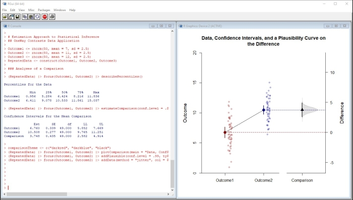

# [`EASI`](https://cwendorf.github.io/EASI)

## Estimation Approach to Statistical Inference

[](https://cran.r-project.org/)
[](https://github.com/cwendorf/EASI/releases/latest)
[](https://www.repostatus.org/#active)

### Overview

`EASI` is an R package that implements features of estimation statistics and data visualization in a pipe-oriented framework. Its primary functions describe, estimate, test, and plot confidence intervals for means, mean comparisons, correlations, and standardized effect sizes in between- and within-subjects single-factor, factorial, and mixed designs. Most functions can take either raw data or summary statistics as input.



Other functions extend the analysis capabilities by offering summaries and plots of data, frequencies, densities, and more. These features can be combined to produce images similar to those from other estimation statistics implementations.



### Installation

This package is not currently available on CRAN. It can be installed directly from GitHub:

``` r
if (!requireNamespace("remotes", quietly = TRUE)) install.packages("remotes")
remotes::install_github("cwendorf/EASI")
library(EASI)
```

If you prefer not to install the package, you can load the current functions directly:

``` r
source("https://raw.githubusercontent.com/cwendorf/EASI/main/source-EASI.R")
```

### Usage

This package includes the following documentation:

- [Introduction](./docs/README.md): A quick overview and summary of the package
- [Reference](./docs/man/README.md): Reference documentation of the functions of the package
- [Articles](./docs/vignettes/README.md): Examples and applications of features of the package

### Citation

Wendorf, C. A. (2024). *EASI: Estimation Approach to Statistical Inference* [R Package]. [https://github.com/cwendorf/EASI](https://github.com/cwendorf/EASI)
