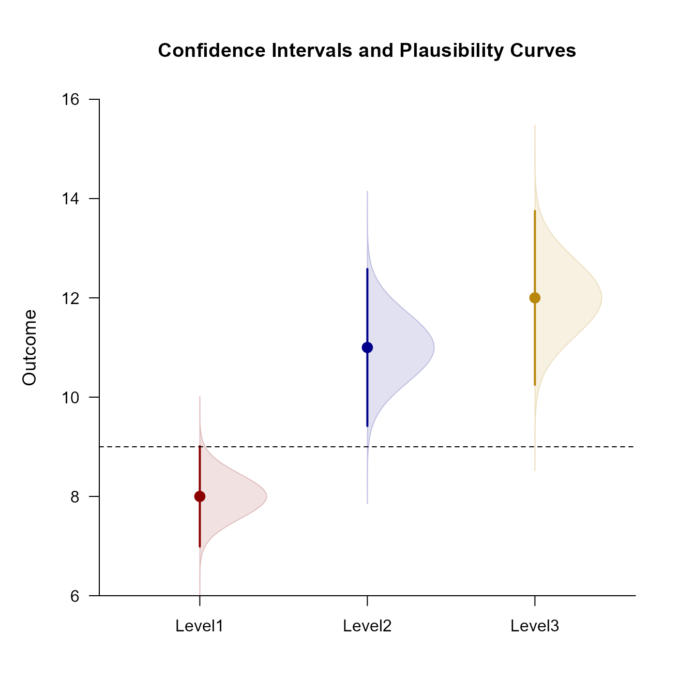
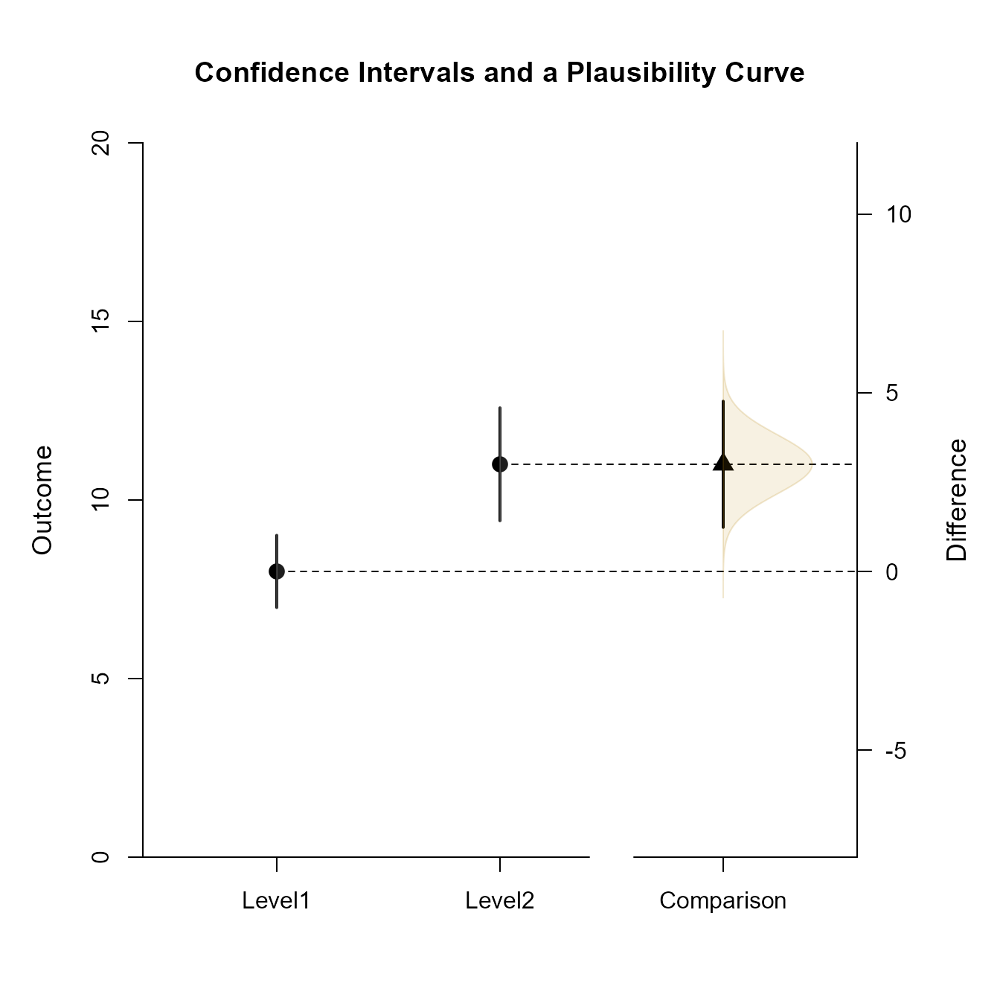
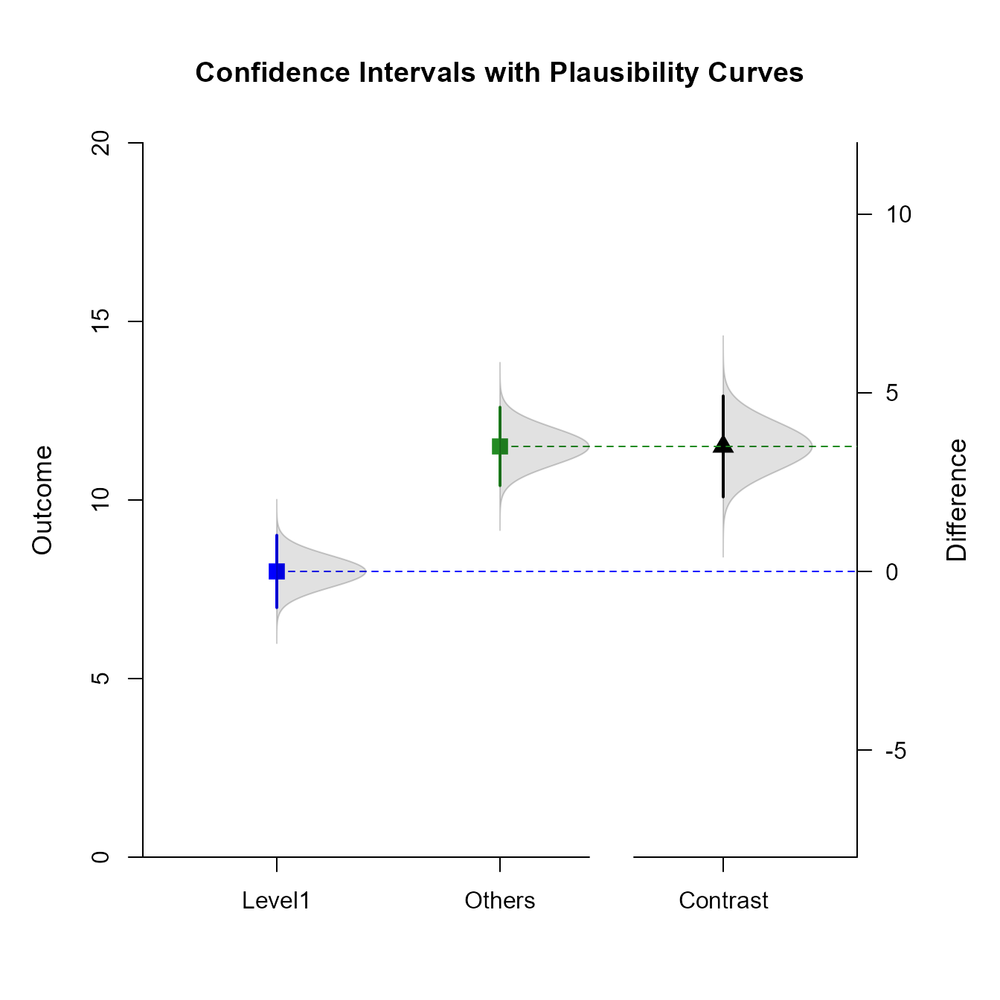

# [`EASI`](https://github.com/cwendorf/EASI/)

## OneWay Summary Advanced

This page examines a single-factor between-subjects (one-way) design using raw data input, adding color and plausibility curves to plots of comparisons and contrasts.

- [Data Management](#data-management)
- [Analyses of the Means](#analyses-of-the-means)
- [Analyses of a Comparison](#analyses-of-a-comparison)
- [Analyses of a Mean Contrast](#analyses-of-a-mean-contrast)

------------------------------------------------------------------------

### Data Management

This code inputs the variable names and creates a viewable data frame.

```r
Level1 <- c(N = 10, M = 8.000, SD = 1.414)
Level2 <- c(N = 10, M = 11.000, SD = 2.211)
Level3 <- c(N = 10, M = 12.000, SD = 2.449)
OneWayMoments <- construct(Level1, Level2, Level3, class = "bsm")
```

### Analyses of the Means

As shown elsewhere, the standard EASI plot includes just the confidence intervals for means plus their values. 

```r
(OneWayMoments) |> plotMeans()
```


To enhance the plot to match other implementations of estimation statistics, it can be have plausibility curves added, have colors modified, and have the values suppresed.

```r
(OneWayMoments) |> plotMeans(main = "Confidence Intervals and Plausibility Curves", values = FALSE, line = 9, col = c("darkred", "darkblue", "darkgoldenrod"))
(OneWayMoments) |> addPlausible(col = c("darkred", "darkblue", "darkgoldenrod"))
```



### Analyses of a Comparison

Select levels for a comparison and get a simple plot of the confidence intervals and values.

```r
(OneWayMoments) |> focus(Level1, Level2) |> plotComparison()
```


Get an enhanced plot that includes a plausibility curve just for the comparison.

```r
(OneWayMoments) |> focus(Level1, Level2) |> plotComparison(main = "Confidence Intervals and a Plausibility Curve", values = FALSE, ylim = c(0, 20))
(OneWayMoments) |> focus(Level1, Level2) |> addPlausible(col = c("white", "white", "darkgoldenrod"))
```



### Analyses of a Mean Contrast

Create a contrast and get a plot of the mean subsets and the contrast (along with their values).

```r
(OneWayMoments) |> plotSubsets(contrast = c(-1, .5, .5), labels = c("Level1", "Others"))
```


Create an enhanced plot of the mean subsets, adding a plausibility curve to the subsets and the contrast.

```r
(OneWayMoments) |> plotSubsets(contrast = c(-1, .5, .5), main = "Confidence Intervals with Plausibility Curves", labels = c("Level1", "Others"), ylim = c(0, 20), values = FALSE, col = c("blue", "forestgreen", "black"))
(OneWayMoments) |> addPlausible(contrast = c(-1, .5, .5), type = c("right", "right", "right"), col = c("black", "black", "black"))
```


