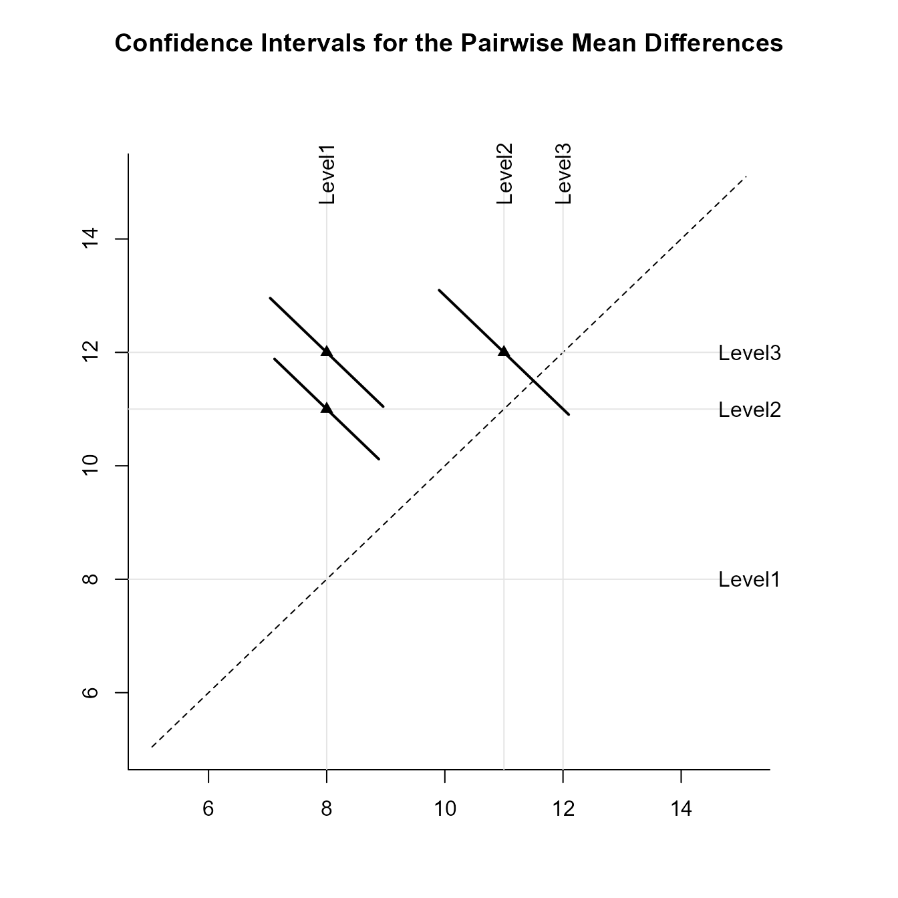
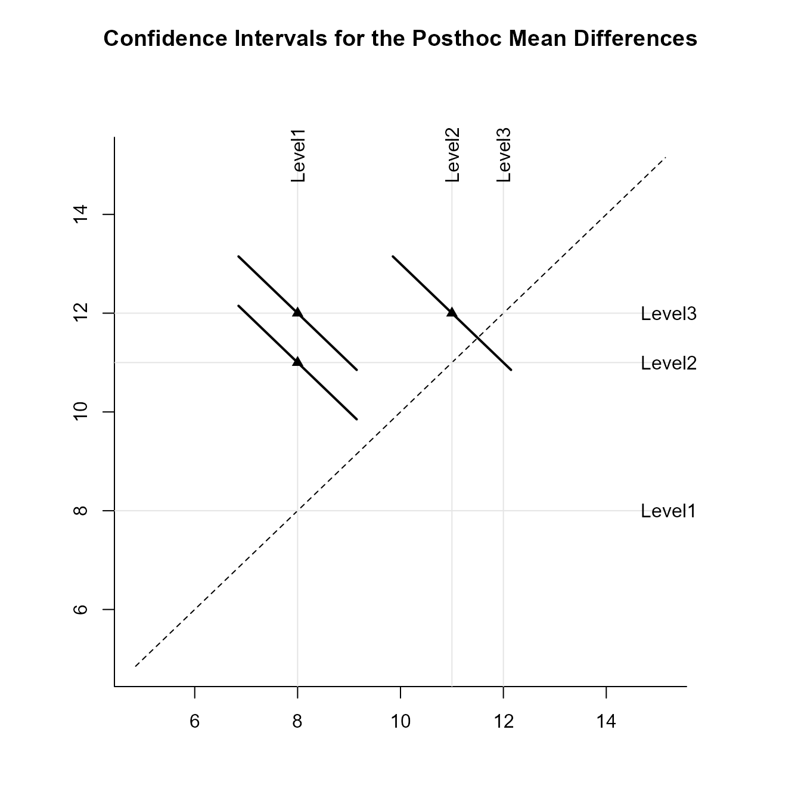

# [`EASI`](https://github.com/cwendorf/EASI/)

## OneWay Summary Traditional

This page examines a single-factor between-subjects (one-way) design using summary statistics input, focusing on omnibus and pairwise analyses.

### Preliminary Tasks

#### Data Entry

This code inputs the group summaries and creates a single summary table.

```r
Level1 <- c(N = 10, M = 8.000, SD = 1.414)
Level2 <- c(N = 10, M = 11.000, SD = 2.211)
Level3 <- c(N = 10, M = 12.000, SD = 2.449)
OneWayMoments <- construct(Level1, Level2, Level3, class = "bsm")
```

#### Summary Statistics

This code confirms the descriptive statistics from the summary table.

```r
(OneWayMoments) |> describeMoments()
```

### Analyses of the Omnibus Effect

The Analysis of Variance examines the overall differences among the means.

#### Source Table

Display the source table.

```r
(OneWayMoments) |> describeEffect()
```

#### Proportion of Variance Accounted for

Get an estimate of the proportion of variance account for by the factor (and the confidence interval for that estimate).

```r
(OneWayMoments) |> estimateEffect()
```

#### Significance Test

Test the overall differences for statistical significance.

```r
(OneWayMoments) |> testEffect()
```

### Analyses of Pairwise Comparisons

The analyses for the pairwise comparisons do not assume homogeneity of variance and do not make adjustments for multiple comparisons (and are therefore effectively equivalent to a series of independent samples t tests).

#### Confidence Intervals

Obtain interval estimates for the pairwise comparisons.

```r
(OneWayMoments) |> estimatePairwise()
```

Provide a traditional plot of the confidence intervals for the pairwise comparisons (including a line that represents no difference for the comparisons).

```r
(OneWayMoments) |> plotPairwise(line = 0, values = FALSE)
```


Provide a diffogram (plot of means and the confidence intervals for the pairwise comparisons).

```r
(OneWayMoments) |> plotPairwiseDiffogram()
```



#### Significance Tests

Test the pairwise comparisons for statistical significance.

```r
(OneWayMoments) |> testPairwise()
```

#### Standardized Effect Sizes

Get the standardized effect sizes (and their confidence intervals) for the pairwise comparisons.

```r
(OneWayMoments) |> standardizePairwise()
```

### Analyses of Relational Intervals

Relational intervals are values (and boxes on a graph) that indicate whether two conditions are statistically significantly different. The analyses for the relational confidence intervals do assume homogeneity of variance but do not make adjustments for multiple comparisons.

Provide estimates of the arelational and relational intervals.

```r
(OneWayMoments) |> estimateRelational()
```

Plot the intervals.

```r
(OneWayMoments) |> plotRelational()
```


### Analyses of Post Hoc Comparisons

The analyses for the post hoc comparisons do assume homogeneity of variance and do make adjustments for multiple comparisons (based on Tukey HSD procedures).

#### Confidence Intervals

Obtain interval estimates for the post hoc comparisons.

```r
(OneWayMoments) |> estimatePosthoc()
```

Provide a traditional plot of the confidence intervals for the post hoc comparisons (including a line that represents no difference for the comparisons).

```r
(OneWayMoments) |> plotPosthoc(line = 0, values = FALSE)
```


Provide a diffogram (plot of means and the confidence intervals for the post hoc comparisons).

```r
(OneWayMoments) |> plotPosthocDiffogram()
```



#### Significance Tests

Test the post hoc comparisons for statistical significance.

```r
(OneWayMoments) |> testPosthoc()
```

#### Standardized Effect Sizes

Get the standardized effect sizes (and their confidence intervals) for the post hoc comparisons.

```r
(OneWayMoments) |> standardizePosthoc()
```
