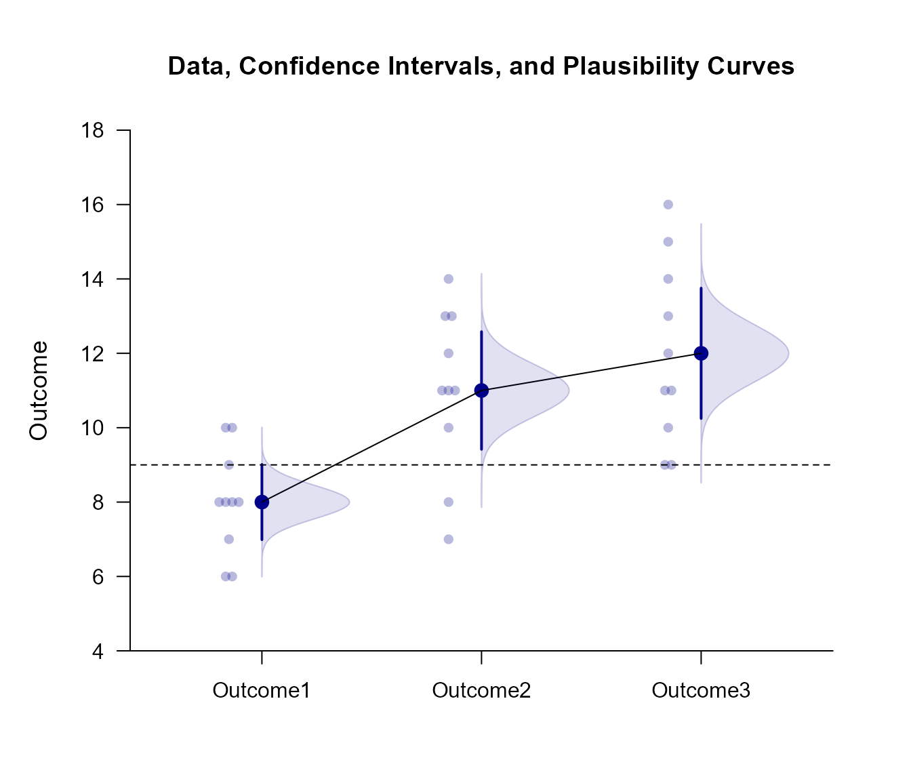
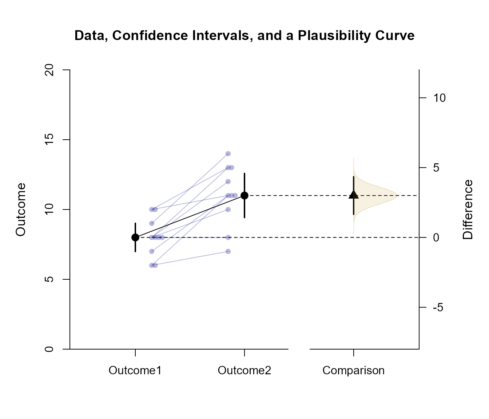
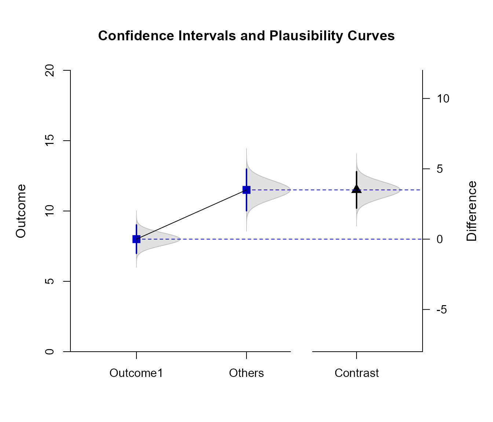

# [`EASI`](https://github.com/cwendorf/EASI/)

## Repeated Data Advanced

This page examines a single-factor within-subjects (repeated measures) design using raw data input, adding data, color, and plausibility curves to plots of comparisons and contrasts.

### Data Management

This code inputs the variable names and creates a viewable data frame.

```r
Outcome1 <- c(6, 8, 6, 8, 10, 8, 10, 9, 8, 7)
Outcome2 <- c(7, 13, 11, 10, 13, 8, 11, 14, 12, 11)
Outcome3 <- c(9, 16, 11, 12, 15, 13, 9, 14, 11, 10)
RepeatedData <- construct(Outcome1, Outcome2, Outcome3)
```

### Analyses of the Means

As shown elsewhere, the standard EASI plot includes just the confidence intervals for means plus their values.

```r
(RepeatedData) |> plotMeans()
```


To enhance the plot to match other implementations of estimation statistics, it can be layered with data plots, have plausibility curves added, have colors modified, and have the values suppresed.

```r
(RepeatedData) |> plotData(main = "Data, Confidence Intervals, and Plausibility Curves", method = "swarm", offset = -.15, col = "darkblue")
(RepeatedData) |> addMeans(values = FALSE, line = 9, col = "darkblue")
(RepeatedData) |> addPlausible(col = "darkblue")
```



### Analyses of a Comparison

Select levels for a comparison and get a simple plot of the confidence intervals and values.

```r
(RepeatedData) |> focus(Outcome1, Outcome2) |> plotComparison()
```


Get an enhanced plot that includes the data along with a plausibility curve just for the comparison. Here the data points for the same individual are connected.

```r
(RepeatedData) |> focus(Outcome1, Outcome2) |> plotComparison(main = "Data, Confidence Intervals, and a Plausibility Curve", ylim = c(0, 20), values = FALSE)
(RepeatedData) |> focus(Outcome1, Outcome2) |> addPlausible(type = c("none", "none", "right"), col = c("white", "white", "darkgoldenrod"))
(RepeatedData) |> focus(Outcome1, Outcome2) |> addData(connect=TRUE, offset=c(.15, -.15), col = "darkblue")
```



### Analyses of a Mean Contrast

Create a contrast and get a plot of the mean subsets and the contrast (along with their values).

```r
(RepeatedData) |> plotSubsets(contrast = c(-1, .5, .5), labels = c("Outcome1", "Others"))
```


Create an enhanced plot of the mean subsets, adding a plausibility curve to the subsets and the contrast. (Due to the combination of levels, data are not plotted.)

```r
(RepeatedData) |> plotSubsets(contrast = c(-1, .5, .5), labels = c("Outcome1", "Others"), main = "Confidence Intervals and Plausibility Curves", ylim = c(0, 20), values = FALSE, col = c("mediumblue", "mediumblue", "black"))
(RepeatedData) |> addPlausible(contrast = c(-1, .5, .5), type = c("right", "right", "right"), col = c("black", "black", "black"))
```


