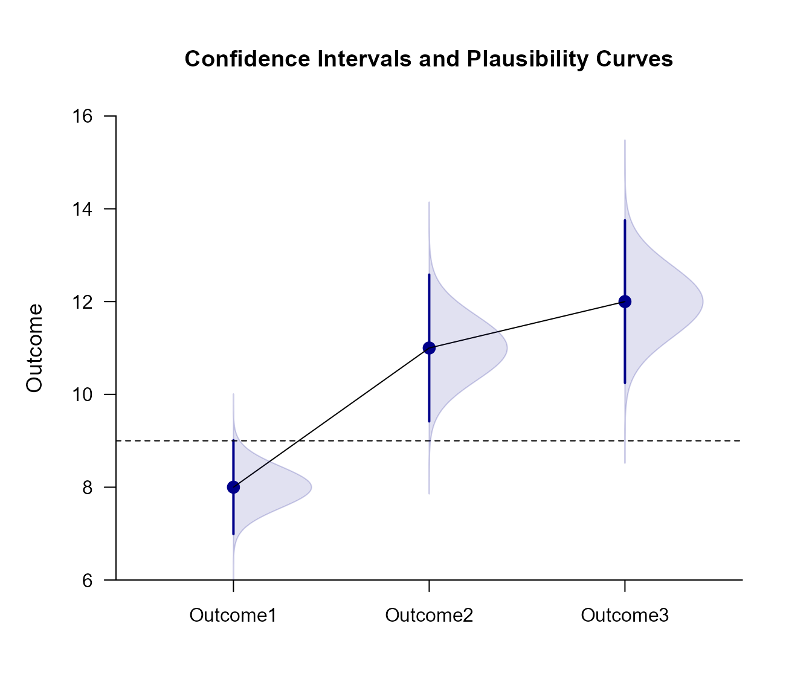
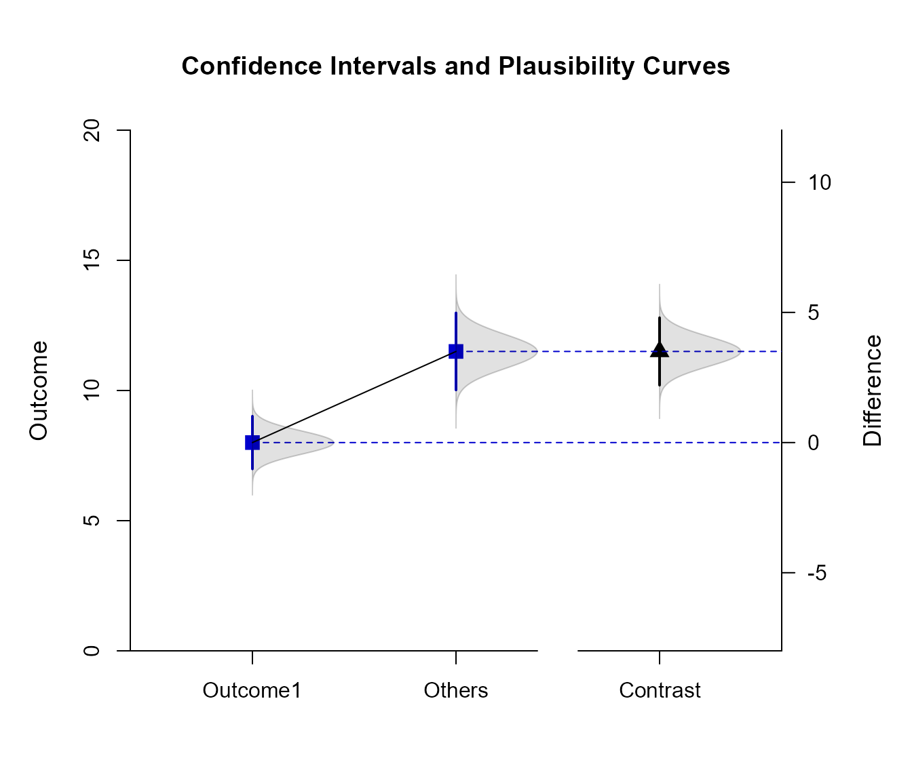

# [`EASI`](https://github.com/cwendorf/EASI/)

## Repeated Summary Advanced

This page examines a single-factor within-subjects (repeated measures) design using summary statistics input, adding color and plausibility curves to plots of comparisons and contrasts.

### Data Management

This code inputs the variable summaries and creates a summary table.

```r
Outcome1 <- c(N = 10, M = 8.000, SD = 1.414)
Outcome2 <- c(N = 10, M = 11.000, SD = 2.211)
Outcome3 <- c(N = 10, M = 12.000, SD = 2.449)
RepeatedMoments <- construct(Outcome1, Outcome2, Outcome3, class = "wsm")
```

This code creates a correlation matrix.

```r
Outcome1 <- c(1.000, .533, .385)
Outcome2 <- c(.533, 1.000, .574)
Outcome3 <- c(.385, .574, 1.000)
RepeatedCorrs <- construct(Outcome1, Outcome2, Outcome3, class = "cor")
```

### Analyses of the Means

As shown elsewhere, the standard EASI plot includes just the confidence intervals for means plus their values.

```r
(RepeatedMoments) |> plotMeans()
```


To enhance the plot to match other implementations of estimation statistics, it can have plausibility curves added, have colors modified, and have the values suppresed.

```r
(RepeatedMoments) |> plotMeans(main = "Confidence Intervals and Plausibility Curves", values = FALSE, line = 9, col = "darkblue")
(RepeatedMoments) |> addPlausible(col = "darkblue")
```



### Analyses of a Comparison

Select levels for a comparison and get a simple plot of the confidence intervals and values.

```r
(RepeatedMoments) |> focus(Outcome1, Outcome2) |> plotComparison(RepeatedCorrs)
```


Get an enhanced plot that includes a plausibility curve just for the comparison.

```r
(RepeatedMoments) |> focus(Outcome1, Outcome2) |> plotComparison(RepeatedCorrs, main = "Confidence Intervals and a Plausibility Curve", ylim = c(0, 20), values = FALSE)
(RepeatedMoments) |> focus(Outcome1, Outcome2) |> addPlausible(RepeatedCorrs, type = c("none", "none", "right"), col = c("white", "white", "darkgoldenrod"))
```


### Analyses of a Mean Contrast

Create a contrast and get a plot of the mean subsets and the contrast (along with their values).

```r
(RepeatedMoments) |> plotSubsets(RepeatedCorrs, contrast = c(-1, .5, .5), labels = c("Outcome1", "Others"))
```


Create an enhanced plot of the mean subsets, adding a plausibility curve to the subsets and the contrast.

```r
(RepeatedMoments) |> plotSubsets(RepeatedCorrs, contrast = c(-1, .5, .5), labels = c("Outcome1", "Others"), main = "Confidence Intervals and Plausibility Curves", ylim = c(0, 20), values = FALSE, col = c("mediumblue", "mediumblue", "black"))
(RepeatedMoments) |> addPlausible(RepeatedCorrs, contrast = c(-1, .5, .5), type = c("right", "right", "right"), col = c("black", "black", "black"))
```


